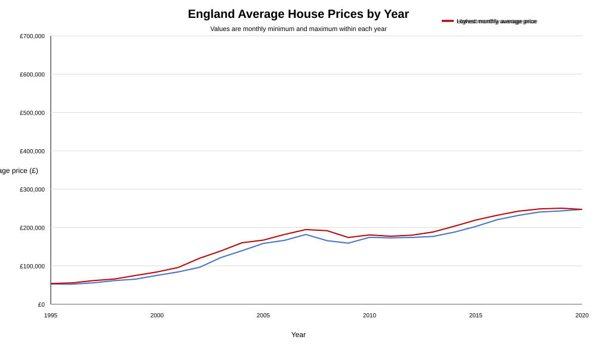
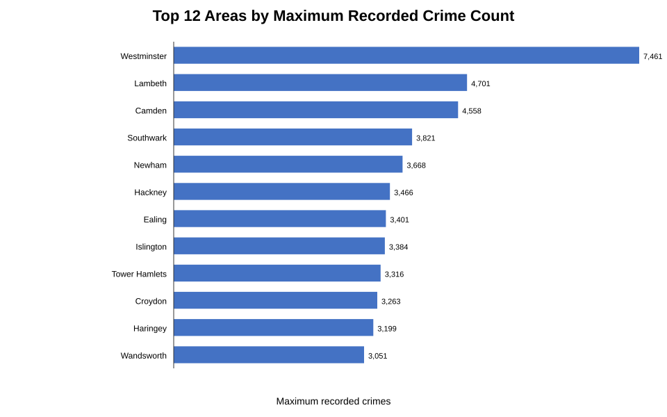

# CISC7204 Data Science Project Collection

**Student:** Chen Tianying (MC641790)
**Course:** CISC7204 Data Science and Data Visualization
**Status:** Completed course collection; selected analyses are ready for portfolio review.

This public project repository documents my semester development from exploratory data analysis to visual communication, interactive graphics, geospatial methods, and statistical reasoning.
## Featured project

### London Housing Prices and Crime Patterns

**Research question:** How do average housing prices and recorded crime counts vary across years and areas in the supplied London housing dataset?

The analysis converts dates, derives year and month fields, compares yearly price extremes, summarizes crime counts by area, and identifies lower-priced records. Representative visuals are available in [`london-housing-analysis/figures/`](london-housing-analysis/figures/). The results are descriptive; the exercise data do not establish a causal relationship between crime and housing prices.

## Featured visualizations

The featured London Housing analysis includes readable outputs with titles and labelled axes. The first figure compares yearly average-price extremes; the second compares recorded crime counts across areas.

*Figure 1. Yearly housing price comparison from the supplied London housing dataset.*

*Figure 2. Area-level crime comparison from the same dataset.*

## Project collection

| Project | Research focus |
|---|---|
| [London Housing Analysis](london-housing-analysis/README.md) | Housing prices, crime counts, years, and areas |
| [Police Data Analysis](police-data-analysis/README.md) | Violations, searches, stop duration, and age distributions |
| [Weather Analysis](weather-analysis/README.md) | Weather conditions and grouped measurement summaries |
| [Cars Data Analysis](cars-analysis/README.md) | Data cleaning, vehicle origins, weight, and fuel economy |
| [COVID-19 Analysis](covid-19-analysis/README.md) | Regional confirmed, death, and recovered cases |

## Course learning areas

- [Visualization basics](visualization-basics/README.md)
- [Advanced visualization](advanced-visualization/README.md)
- [Geospatial visualization](geospatial-visualization/README.md)
- [Interactive visualization](interactive-visualization/README.md)
- [Statistical reasoning](statistical-reasoning/README.md)

## Methods and tools

Python, pandas, NumPy, Matplotlib, Seaborn, SciPy, Jupyter Notebook, Bokeh, Plotly, Folium, and related visualization libraries.

## Reproducibility

1. Clone or download this repository.
2. Create a Python 3 environment.
3. Run `pip install -r requirements.txt`.
4. Open a project's Notebook from its own folder and run cells in order.
5. Use the project README to identify the research question, files, data note, and limitation.

The main EDA notebooks use relative paths and do not require the original course folder. Some geospatial notebooks use legacy packages; their README identifies that environment limitation.

## Responsible sharing

The datasets came from course exercise materials. Before public release, verify each original provider's licence and attribution requirements. No passwords, API keys, or private records are included.
