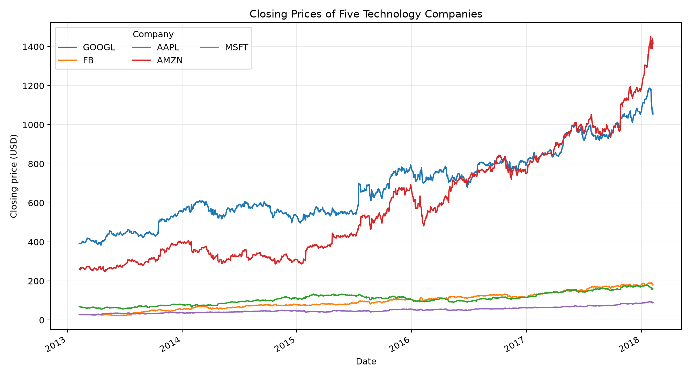
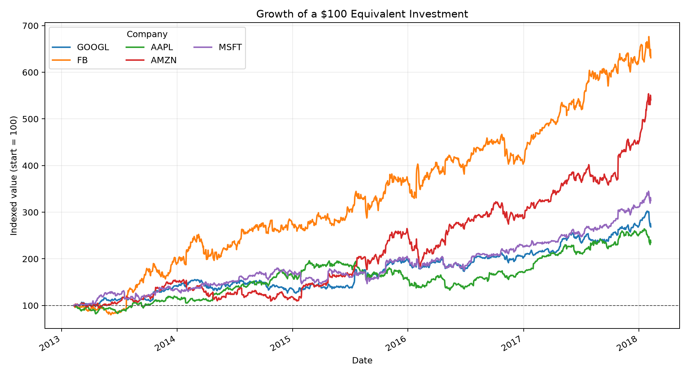

# Technology Stock Trends, 2013-2018

## Research question

How did the closing prices of Alphabet (GOOGL), Meta/Facebook (FB), Apple (AAPL), Amazon (AMZN), and Microsoft (MSFT) change from 8 February 2013 to 7 February 2018, and which stock recorded the greatest percentage growth over that period?

## Dataset and permission

The analysis uses five CSV files supplied for CISC7204 coursework. Each file contains 1,259 daily observations with date, open, high, low, close, volume, and ticker fields. The structure and period correspond to the public [S&P 500 stock data](https://www.kaggle.com/datasets/camnugent/sandp500) dataset on Kaggle, which lists its source data as public-domain (CC0). The included files are used here for educational and portfolio purposes. Users should verify the source terms before redistributing the data outside this context.

No credentials, personal data, or restricted information are included.

## Methods and tools

- Python, pandas, Matplotlib, and Jupyter Notebook
- Date parsing and combination of five company-level CSV files
- Line charts of raw closing prices
- Indexing each stock to 100 on the first date for a like-for-like growth comparison

## Key findings

The raw-price chart shows Amazon ending with the highest share price. The indexed comparison gives the more meaningful relative result: Facebook recorded the largest increase, approximately **531.2%**, followed by Amazon at **440.9%**. Microsoft rose about **225.3%**, Alphabet about **168.5%**, and Apple about **135.1%** between the first and last observations.





## Limitation

Closing-price growth alone does not represent total investor return because the analysis does not adjust for dividends, stock splits, transaction costs, inflation, or risk. It also describes historical performance and should not be interpreted as investment advice.

## Reproduce the analysis

1. Clone this repository and enter its folder.
2. Create and activate a virtual environment.
3. Install the dependencies with `pip install -r requirements.txt`.
4. Run `python analysis.py` to regenerate both images in `visualizations/`.
5. Optionally open `notebooks/mc641790_Activity6.01.ipynb` in JupyterLab to review the original notebook analysis.

The script uses paths relative to the repository, so it can be run from any working directory.

## Repository structure

```text
data/
  AAPL_data.csv, AMZN_data.csv, FB_data.csv, GOOGL_data.csv, MSFT_data.csv
notebooks/
  mc641790_Activity6.01.ipynb
  mc641790_Activity6.02.ipynb
  mc641790_Exercise6.01.ipynb
visualizations/
  closing-price-trends.png
  normalized-growth.png
analysis.py
requirements.txt
```

## Author

CHEN TIANYING (`mc641790`)  
CISC7204 Data Science Programming
